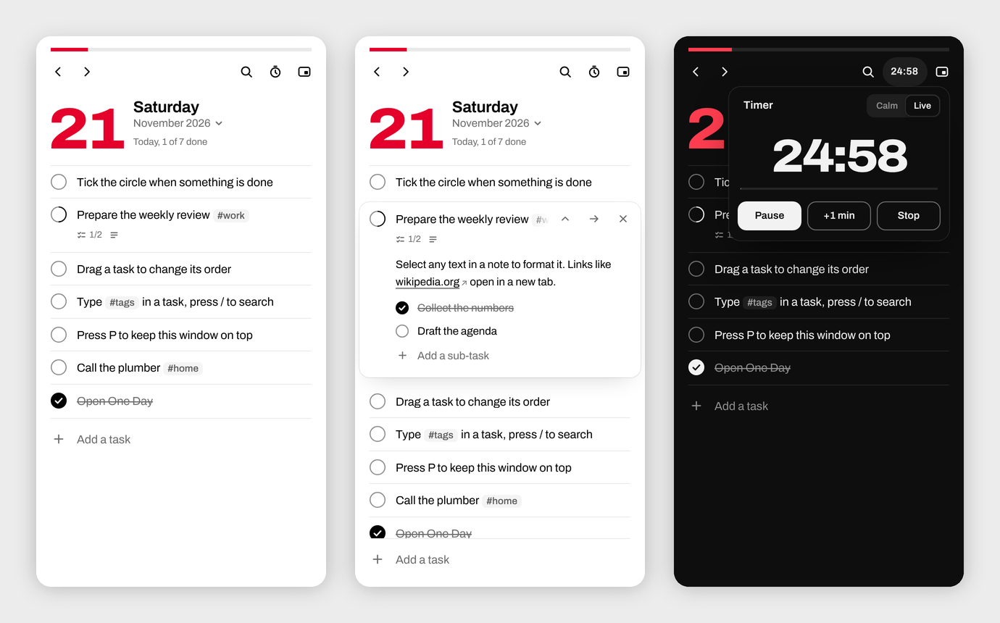

# One Day

A calm, minimalist task list that shows **one day at a time**, floats above your other windows, and keeps your data yours: on your device, or encrypted in your own cloud if you sync.

**[Open One Day →](https://day.bemorin.com)** · [Read the guide](https://day.bemorin.com/guide/): every feature in plain words, with pictures, and answers to common questions.

![One Day in motion: bringing yesterday's leftovers to today, adding a task, pasting a list, undo, opening a task, sending a task to tomorrow, the mouse wheel through the days, making a task repeat, sending it as a link, giving tags colours and showing one tag, search, the timer, the rest of the day ticked off, its last task rising into a big check as the full days count one more, then folding into the bar, light and dark, locking with a passphrase, then the same app on a phone, its search rising as a drawer](docs/demo.webp)

[Watch the demo in HD (MP4, 1080p)](https://github.com/bemorin/one-day/releases/download/v1.4.0/one-day-demo.mp4)

One Day is a single-page web app with no framework, no runtime dependencies, no account and no tracking. Open it, write down what today is for, tick things off, and move on to tomorrow.

## Features

- **One day on screen.** Move between days with the arrows, a swipe, the mouse wheel (up for the day before, down for the day after), a trackpad gesture or the month picker. The date rolls like a counter, and the thick rule at the top fills up as you finish the day.
- **A sheet that fits its content.** On a large screen the day is a card on the page, resting in a thin frame of glass. It grows and shrinks on a spring as tasks come and go. On a phone it fills the screen.
- **Add to any day.** The composer adds to the day on screen. Its day chip sends a task to another day (Today, Tomorrow, Next week or any date) without leaving the one you are on.
- **Paste a list.** Paste several lines into the composer, or into a card's sub-task field, and each line becomes a task (or a sub-task). Bullets, numbers and checkboxes are left out, as Markdown, Notion, notes and to-do apps write them, and ticked items (`- [x]`, ☑, ✅) come in done. In the composer, a line set further in than the one above (as Notion and Markdown nest them) comes in as its sub-task. One undo takes them all back.
- **Bring your tasks from another app.** _Import backup_ also reads Todoist, TickTick, Google Tasks, Evernote and todo.txt exports, and tables saved as CSV (Coda, Any.do's boards, a spreadsheet), in the browser, and shows where they will go before adding them (see [Coming from another app](#coming-from-another-app)).
- **Repeat.** A task can come back every few days, weeks or months: on chosen weekdays, or on a date or a weekday of the month. Each occurrence appears when its day comes; ticking or deleting one leaves the others alone, and missed ones don't pile up as leftovers.
- **Send a task, or the whole day.** Share a task as a link from its card, or all of the day's open tasks at once (to someone else, or to yourself on another device). The task travels inside the link, after the `#`, which browsers never send to a server; whoever opens it can add it to their own One Day, on the day they choose.
- **Tasks from your assistant.** Claude, ChatGPT or any assistant can write such a link for you: several tasks at once, each with a note, sub-tasks, a day and a repeat. One Day shows them all, each with a box to untick it, and adds them in one go, with one undo. The [link format](docs/links.md) is open, Claude Desktop and Claude Code get a small local [MCP server](mcp), and other assistants only need a paragraph of instructions.
- **Tasks that feel physical.** Tick, drag to reorder, send to tomorrow, delete. Every action can be undone, and every motion is driven by springs.
- **Notes and sub-tasks.** Click a task to open it: a rich-text note (bold, italic, strikethrough, code, lists, links) and a checklist. The task's circle fills as the checklist gets done. Click the title of an open task, or double-click any task, to rename it.
- **Tags.** Type `#anything` in a task or a sub-task. Tags autocomplete, and clicking one searches for it.
- **Search.** Instant, accent-insensitive search across every day, every note and every sub-task.
- **Timer.** A countdown in two moods: _Calm_ (minutes, with a line that fills each minute) or _Live_ (rolling minutes and seconds).
- **Keep on top.** Pop the app into a small window that stays above everything else (Chrome and Edge on desktop).
- **Leftovers.** Unfinished tasks from earlier days can be brought to today in one click.
- **Full days.** Tick the last task of a day and its circle rises into a big check over the day, the count under it going up by one, then it all folds into the number in the middle of the bar: the full days, those whose tasks were all ticked. It is counted from your tasks, and a day you miss takes nothing away: there is no streak to break. A day gone by whose unfinished tasks you carried on (Bring here, or a task's arrow) keeps a mark and doesn't count; putting a task off on its own day, or deleting it, doesn't count against the day. Untick or undo, and the day leaves the count. In a narrower window, where the time sits in the bar, the count takes its place for five seconds now and then. With _Reduce motion_ on, the check and the count just show for a moment, without moving, and a screen reader hears it.
- **Tags.** Type `#something` in a task. The filter at the right of the date shows only the tasks with one tag, and the dot beside a tag gives it a colour, worn wherever it shows.
- **Sync with your own cloud, if you want.** The cloud beside the lock (_Sync with your cloud_) keeps the same tasks on your phone and your computer through your own Google Drive, Dropbox or OneDrive (iCloud is coming soon). There is no account and no server of ours: the browser talks to your cloud directly, and your tasks are encrypted with a passphrase before they leave it. Two devices that changed the same day are merged task by task, offline changes go up once you are back, and a cloud beside the lock says how it is going (see [Privacy](#privacy) and [Security](#security)).
- **A lock, if you want one.** _Protect with a passphrase_ (the lock at the top right) encrypts your tasks in the browser; search before you type (More on a phone) then has what changes it or turns it off. One Day then asks for the passphrase when it opens, after five minutes away, or as soon as you press <kbd>L</kbd>. Where the device has it, fingerprint, face or the device PIN unlocks it too (setting it up asks for the passphrase).
- **On a phone**, a bottom bar puts search, the timer, a big add button, sending the day and the rest under your thumb. The add button opens the composer as a sheet above the keyboard, and search opens as a drawer over the day. The phone's back button closes what is open (a sheet, the drawer, a popover, an open task) before it leaves the app.
- **Light and dark**, following your system, or switched in one click (the sun and moon at the top right). **Works offline** once installed, and installs as an app.



## Coming from another app

Search → _Import backup_ (More on a phone) also reads what other to-do apps export. Pick the file, or the `.zip` it came in: One Day knows it by what it holds, whatever it is called. Before anything is added, it shows how many tasks will come and on which days; _Add all_ brings them in one step, and one undo takes them all back. The file is read here, in your browser: nothing is sent anywhere.

| App              | What to pick                                                                                                                                                                                                                       | What comes over                                                                                                                                                                                                 | What stays behind                                                                                                                                  |
| ---------------- | ---------------------------------------------------------------------------------------------------------------------------------------------------------------------------------------------------------------------------------- | --------------------------------------------------------------------------------------------------------------------------------------------------------------------------------------------------------------- | -------------------------------------------------------------------------------------------------------------------------------------------------- |
| **Todoist**      | One project: its ⋯ menu → _Import & export → Export to CSV_. Every project at once: _Settings → Backups_ (paid plans), the `.zip` as it is.                                                                                          | Open tasks, their descriptions and comments (with their files as links), sub-tasks, labels and the project as tags, dates, deadlines, repeats written in English                                                 | Done tasks: Todoist never exports them, so no history. Sections, priorities, times, reminders, durations, assignees; repeats in other languages go in the note |
| **TickTick**     | In the web app: _Settings → Account → Backup & Import → Generate Backup_, a `.csv`                                                                                                                                                  | Open and done tasks (each on the day it was done), their content, checklist items and sub-tasks, tags and the list as tags, dates, repeats                                                                        | Tasks marked _Won't do_, notes, priorities, times, reminders, folders and kanban columns                                                           |
| **Google Tasks** | [Google Takeout](https://takeout.google.com) with only _Tasks_ ticked: the `.zip` as it is, or the `Tasks.json` inside                                                                                                             | Open and done tasks (each on the day it was done), notes and links, sub-tasks, the list as a tag, dates, and the repeats each list keeps                                                                         | Times, stars, assignees                                                                                                                            |
| **todo.txt**     | `todo.txt` and `done.txt`, both at once                                                                                                                                                                                            | Open and done tasks (each on the day it was done), `+projects` and `@contexts` as tags, `due:` (else `t:`, the day it may start), `rec:` repeats                                                                  | Priorities and creation dates; other `key:value` tags stay in the task's words                                                                     |
| **Evernote**     | In the desktop app: right-click a notebook (or the notes) → _Export…_ → ENEX, the `.enex` file                                                                                                                                      | Notes with checkboxes (a task each: its checklist as sub-tasks, the rest as its note), Evernote Tasks (each on its due day, done ones on the day they were done), notes with a reminder, tags and the notebook as tags, repeats | Notes with no checklist, task or reminder; pictures and files; flags, reminders and assignees |
| **Coda, Any.do and other tables** | A table saved as CSV: Coda's _Download as CSV_, an Any.do board's _Print and Export → CSV_, a Notion database, Airtable, a spreadsheet                                                                                   | Its rows, found by the names of its columns: the task (or name, title), done, the day it was done, a due date, notes, tags (or list, project), a repeat; in English, French, German or Spanish | Every other column; a done row with no date at all |

How the tasks land:

- **A done task goes on the day it was done**, so your history comes too, where the export has it. A task with a date goes on that day (an overdue one on its day, so it waits among the leftovers), and the rest on today.
- **Lists, projects and labels become `#tags`**, in lower case, with hyphens for spaces. The list every account starts with (Inbox, My Tasks) brings none.
- **Notes come along**, with their links, bold and lists, and so do **sub-tasks**. One Day has one level of them: deeper ones join the task at the top, and their own notes join its note.
- **A repeat becomes a One Day repeat when it fits:** every few days, weeks, months or years, on weekdays, or on a date or a weekday of the month (the 15th, the last day, the second Tuesday). It shows up next on its day, and the dialog lists every repeat before anything is added. One that counts from the day it was done (Todoist's `every!`, todo.txt's `rec:` without `+`) counts from the task's day instead. Todoist doesn't export a repeat's next date, so its repeats count from today. Any other repeat (every other weekday, twice a month, a set number of times…) comes in once, with the repeat written in its note.
- **Todoist writes its dates from the day of the export** ("today", "in 4 days") unless _Use relative dates_ is unticked: One Day counts them from the day the file was saved, and the dialog says so when that isn't today. Backups write short dates in the account's language ("Aug 2", "10 Apr"); a date One Day can't read goes in the task's note.
- **Left behind everywhere:** priorities, times of day, reminders and durations. One Day plans days, not hours.
- **One Day's limits hold:** 300 tasks a day, 100 sub-tasks a task, 300 repeating tasks (one past them comes in once, its repeat in its note), and what the browser can keep (about 5 MB: past that, the oldest done tasks are left out, and if it still can't keep it all, nothing is added). The dialog says what was left out.
- **Twice is too many:** an export brought in again would make doubles. The dialog says when its tasks are already there, on the same days.

A table's dates are read whichever way it writes them (2026-11-24, Nov 24, 2026, 24/11/2026): when its dates leave it open (4/6/2026), they are read as this browser writes dates, and the dialog says so.

Things, Apple Reminders, Microsoft To Do, a Notion page and Any.do's own lists have no export One Day can read (Any.do prints its lists as PDF). Select the tasks there, copy them, and paste them into the composer: each line becomes a task (see _Paste a list_ above). A plain `.txt` or Markdown list file is read the same way.

Made-up sample exports, one per app, are in [`tests/fixtures/imports`](tests/fixtures/imports).

## Keyboard

| Action                            | Keys                                                                                                       |
| --------------------------------- | ---------------------------------------------------------------------------------------------------------- |
| Previous or next day              | <kbd>←</kbd> <kbd>→</kbd> (or <kbd>Alt</kbd> + arrows while typing)                                        |
| Back to today                     | <kbd>D</kbd> or <kbd>Home</kbd>                                                                            |
| Timer                             | <kbd>T</kbd>                                                                                               |
| New task                          | <kbd>N</kbd>, then <kbd>Tab</kbd> to the day chip to pick another day                                      |
| Search                            | <kbd>/</kbd> or <kbd>Ctrl</kbd>/<kbd>⌘</kbd> <kbd>K</kbd>                                                  |
| Keep on top                       | <kbd>P</kbd>                                                                                               |
| Lock now (with the lock on)       | <kbd>L</kbd>                                                                                               |
| Undo, redo                        | <kbd>Ctrl</kbd>/<kbd>⌘</kbd> <kbd>Z</kbd>, <kbd>Ctrl</kbd> <kbd>Y</kbd> or <kbd>⌘</kbd> <kbd>⇧</kbd> <kbd>Z</kbd> |
| Move between tasks                | <kbd>↑</kbd> <kbd>↓</kbd>                                                                                  |
| Reorder a task                    | <kbd>Alt</kbd> <kbd>↑</kbd> <kbd>↓</kbd>                                                                   |
| Rename a task                     | <kbd>Enter</kbd> on its circle                                                                             |
| Open its note while renaming      | <kbd>Tab</kbd>                                                                                             |
| Delete a task                     | <kbd>Delete</kbd> or <kbd>Backspace</kbd> on its circle                                                    |
| Format a note                     | <kbd>⌘</kbd> <kbd>B</kbd> / <kbd>I</kbd> / <kbd>E</kbd> / <kbd>K</kbd>, or Markdown: `**bold**`, `*italic*`, `` `code` ``, `~~strike~~`, `- list` |

On a phone: tap a task to open it, hold then drag to reorder, swipe sideways to change day.

## Privacy

- **Your tasks stay on your device.** They are stored in your browser's `localStorage` for this site. There is no server, database or account behind the app, so whoever hosts it cannot see them.
- **Unless you sync them with your own cloud, and then only there, encrypted.** Sync is off until you turn it on. Then your tasks also go to the Google Drive, Dropbox or OneDrive account you sign in to, into the one folder One Day may open there (a hidden folder in Google Drive, One Day's folder under Apps in Dropbox and OneDrive), as one file encrypted in your browser with your sync passphrase. Your cloud provider sees that file, its size and when it changes, never a task; One Day's host sees none of it, and the browser talks to your cloud directly. You sign in on the cloud's own page; of its answer One Day keeps only the token, which opens that folder and nothing else. The provider's own privacy policy covers your account with them.
- **What the browser keeps for One Day**, all in its `localStorage`: your tasks (`oneday.v1`, or `oneday.vault` when the lock is on), the timer's settings (`oneday.timer`), your light or dark choice (`oneday.theme`) and, if you put off the offer to install it, that you did (`oneday.install`). With sync on, also its key, the copy last agreed with your cloud and your sign-in to it (its tokens: Google's lasts an hour, OneDrive's renews for a day, Dropbox's until you stop syncing), all kept with your tasks: inside `oneday.v1`, or sealed inside `oneday.vault` with the lock on. While you sign in, the tab keeps the sign-in's state for a few minutes in its `sessionStorage` (`oneday.signin`, `oneday.signedin`), and, when the cloud's page opened apart from the tab (a home-screen app may do so), its answer in `localStorage` (`oneday.signedin`) until a tab takes it, or until One Day next opens after 15 minutes (for Google that answer is a token good for an hour, in clear even with the lock on, so it is kept as briefly as the page allows). The service worker's cache (`one-day-v…`) holds the app's own files, its guide and the page your cloud sends you back to, nothing else.
- **No cookies, no analytics, no third-party requests.** The font is bundled with the app, and the Content Security Policy only lets the app's own files load. Its `connect-src` also lets in the APIs of the three clouds, used only once you turn sync on. The footer links are plain links: nothing is contacted until you click one. The dogood.day link tells that site you came from One Day, in its address (`utm_source=day.bemorin.com`) and as the referrer (the site's address only, no page and no identifier); the others send nothing.
- **The service worker caches the app's files (and its guide) only**, so it opens instantly and works offline. It never reads your tasks, and lets every call to a cloud go by untouched.
- **Sent tasks travel in the link itself**, after the `#`, never through a server. Anyone who has the link can read the task, as with any message. The same goes for links written by an assistant: its provider sees what you ask it, as always, but no One Day server is involved, and the [MCP server](mcp) runs on your computer without any network access. See [docs/links.md](docs/links.md#privacy-plainly).
- **Works offline, even from a cold start**, once you have opened it online one time. Install it (or add it to your Home Screen) so the browser keeps its storage: Safari can clear the data of sites you have not opened for a week.
- **Backups are yours.** Search → _Export backup_ downloads a JSON file (encrypted when the lock is on). _Import backup_ merges one back without overwriting existing tasks. It reads other apps' exports the same way: in the browser, with nothing sent anywhere, and nothing stored but the tasks it adds.
- **The lock is optional, and only yours.** With a passphrase, your tasks are kept encrypted in the browser and backups are encrypted too. Nobody can open them without it, not even the maker of One Day, so a forgotten passphrase cannot be recovered: the only way out is to erase the tasks and start again. Changing the passphrase changes the key that encrypts them, so an old copy and the old passphrase open nothing written since. If your browser saves the passphrase, it can fill it in for anyone using that browser. Tasks saved before you turned the lock on can stay in the browser’s own files for a while, until it clears them.
- **Erasing everything:** clear this site's data in your browser settings. With sync on, first _Stop syncing_ with _Also erase One Day's copy_ ticked, on every device.

The hosting provider sees ordinary request logs (IP address, browser), as for any website. If you publish your own copy, link your legal notice and privacy policy from the footer in `public/index.html`.

## Security

- Rich text is cleaned through an allow-list (`b`, `i`, `u`, `s`, `code`, `a`, lists, line breaks). Every other tag and every attribute is dropped. Links are limited to `https`, `http` and `mailto`, and open with `rel="noopener noreferrer"`.
- Everything else is inserted as text, never as HTML. Ids from storage or backups are checked before they reach a selector.
- A strict Content Security Policy blocks inline scripts, remote code and outgoing connections. On Cloudflare Pages, [`public/_headers`](public/_headers) adds HSTS, `frame-ancestors 'none'`, `nosniff`, a no-referrer policy and a locked-down Permissions-Policy.
- The lock uses the browser's Web Crypto API and nothing else. A random 256-bit key encrypts the tasks with AES-GCM. That key is sealed with a key derived from the passphrase (PBKDF2-SHA-256, 600,000 iterations, random salt) and, if you choose, with one derived from a passkey through the WebAuthn PRF extension (HKDF-SHA-256). While locked, the app holds no decrypted task, and it locks itself after five minutes in the background.
- Sync encrypts in the browser, with the same Web Crypto API. A random 256-bit key encrypts the tasks (AES-GCM), compressed first; a key derived from the sync passphrase (PBKDF2-SHA-256, 600,000 iterations, random salt) seals that key, and the cloud holds both, sealed, in one file that is also an encrypted backup. Each device keeps the key and its sign-in with the tasks (sealed with them when the lock is on), so sync runs without asking again. Sign-in goes through each cloud's own page, with no client secret: OAuth 2 with PKCE for Dropbox and OneDrive, Google's token flow for a page without a server (an hour, no refresh). The scopes are the narrowest: Google Drive's `drive.appdata`, Dropbox's App folder, OneDrive's `Files.ReadWrite.AppFolder`. A sign-in again must reach the same account as the first (Google's Drive user, Dropbox's account, OneDrive's drive): another one is refused, so a device never moves on to another account's copy without a word. A sign-in answer is only taken when it carries the random state the page started with; the page the cloud sends you back to (`oauth/`) reads it in the browser, and when the service worker answers it, the one-time code in its address never reaches the host.
- No runtime dependencies, so there is no supply chain to compromise. The dev dependencies (Playwright, axe-core) are only used for tests and icons.

Found a problem? See [SECURITY.md](SECURITY.md).

## Accessibility

One Day targets **WCAG 2.2 AA**: everything works with a keyboard (including a keyboard alternative to dragging), controls have accessible names, focus is visible and returns where it came from, text meets 4.5:1 contrast, and all motion is turned off when _Reduce motion_ is on.

The test suite runs [axe-core](https://github.com/dequelabs/axe-core) on the main view, an open card, search, the timer, the day picker, incoming tasks, the import dialog, the full days (a day just sealed, and the count in the time's place) and sync's dialog (the clouds, a new passphrase, sync on, stopping), in light and dark. Automated checks cover a subset of WCAG, so testing with VoiceOver or NVDA is still worthwhile.

## Install it as an app

Until it is installed, One Day offers it: in the middle of the time's line on a large screen (its cross puts the offer off for good, into a small button beside the sun), behind the ⋮ button in a narrower window, and first in More on a phone. In Chrome and Edge it opens the browser's own install prompt; in Safari it says where to look. You can also:

- **Chrome or Edge:** click the install icon in the address bar.
- **Safari on macOS:** _File → Add to Dock_.
- **iPhone and iPad:** _Share → Add to Home Screen_.

In Chrome and Edge on desktop, press <kbd>P</kbd> to keep the app on top of other windows. That uses the [Document Picture-in-Picture API](https://developer.chrome.com/docs/web-platform/document-picture-in-picture), which Safari and Firefox don't support yet.

## Deploy

The site is the `public/` folder, served as is: there is no build step.

### Cloudflare Pages

1. In Cloudflare, go to **Workers & Pages → Create → Pages → Connect to Git** and pick this repository (private repositories work too).
2. Framework preset **None**, build command empty, build output directory **`public`**. ([`wrangler.jsonc`](wrangler.jsonc) says the same.)
3. **Custom domains → Set up a custom domain**, for example `day.example.com`. If the domain's DNS is on Cloudflare, the record is created for you; otherwise add a `CNAME` to `<project>.pages.dev`.
4. Leave **Web Analytics** off and make sure **Rocket Loader** is off for the domain: both inject scripts that the Content Security Policy blocks.

Every push to `main` deploys; every other branch gets a preview URL.

### Sync, on your own copy

Sync talks to each cloud as an app registered there, with One Day's address as the only place it sends you back to. `CLOUD_IDS` in [`public/app.js`](public/app.js) holds One Day's own public ids, which only work on One Day's addresses. A copy published elsewhere needs its own registrations: create them (Google Cloud console, Dropbox App Console, Microsoft Entra), with `https://<your address>/oauth/` as the redirect address, then put their public ids in `CLOUD_IDS` in place of One Day's ([docs/sync-setup.md](docs/sync-setup.md) has the steps). None of them is a secret. Until a cloud has an id, its row in the dialog says it isn't set up yet.

## Develop

```sh
npm install        # dev tools only: Playwright and axe-core
npm start          # http://localhost:8000, with the same headers as production
npm test           # end-to-end and accessibility tests (Chromium)
npm run shots      # the guide's screenshots and the shared-link pictures, from made-up tasks, after any visible change
```

```
public/                 the site
  index.html            markup
  app.css               styles, light and dark
  app.js                the whole app
  sw.js                 offline cache for the app's own files
  oauth/                where a cloud sends you back after you sign in (sync)
  clouds/               each cloud's logo in sync's dialog, as its owner publishes it (see License)
  manifest.webmanifest  install metadata
  _headers              security headers (Cloudflare Pages)
  guide/                the guide (/guide/): one page, its stylesheet and script, shots/ from npm run shots
  share.jpg             the picture a shared link shows (guide/share.jpg for the guide), from npm run shots
  llms.txt              a short summary for AI assistants, pointing to the guide
  llms-full.txt         the whole guide in Markdown for AI assistants (npm run llms after the guide changes)
  robots.txt            every crawler welcome, AI ones included; points to sitemap.xml (the app and the guide)
  fonts/                Archivo, self-hosted (SIL Open Font License)
  icons/, favicon.ico   generated by scripts/icons.mjs
scripts/
  serve.mjs             local server that applies _headers
  icons.mjs             draws the icon and writes every size
  build-standalone.mjs  one self-contained HTML file (dist/one-day.html)
  demo-video.mjs        the demo video, 1080p60 and 720p (npm run video, needs ffmpeg)
  llms-full.mjs         writes public/llms-full.txt from the guide's own Markdown copy (npm run llms)
  guide-shots.mjs       the guide's screenshots (light and dark, computer and phone, the live timer rolling) and
                        the shared-link pictures (npm run shots)
mcp/                    the local MCP server for Claude (one tool, no dependencies)
docs/links.md           the link format that carries tasks into One Day
skills/one-day/         the same, as a skill for ChatGPT or Claude
tests/                  Playwright tests
  clouds.mjs            made-up Google Drive, Dropbox and OneDrive, for sync's tests and the guide's pictures
  fixtures/imports/     made-up exports from Todoist, TickTick, Google Tasks, Evernote, todo.txt and tables
```

After changing any file the service worker caches (the guide's included), bump `CACHE` in `public/sw.js` so installed copies update. After a visible change, run `npm run shots` so the guide's pictures show the app as it is.

## Browser support

Current Chrome, Edge, Safari and Firefox. Keep-on-top needs Chrome or Edge 116 or later on desktop. Spring easing uses CSS `linear()` and falls back to standard curves in older browsers; continuous card corners use `corner-shape` where it exists.

## Made by

[Ben Morin](https://bemorin.com) · [@benmorinbm on X](https://x.com/benmorinbm). If you also keep a journal, try [dogood.day](https://dogood.day).

If One Day helps your days, you can [buy me a coffee](https://ko-fi.com/bemorin) ☕ or [sponsor it on GitHub](https://github.com/sponsors/bemorin).

## License

The code is under the [MIT License](LICENSE). The One Day name and icon are not covered by it: if you publish a fork, give it your own. The Archivo typeface is © The Archivo Project Authors, under the [SIL Open Font License 1.1](public/fonts/OFL.txt).

The logos in `public/clouds/` are not covered by it either: they belong to their owners and are used as each allows apps that work with it to show them. Google Drive is a trademark of Google LLC, and Dropbox of Dropbox, Inc.; Microsoft and OneDrive are trademarks of the Microsoft group of companies, and the OneDrive icon is used under the Microsoft Fabric Assets License. One Day is not affiliated with or endorsed by any of them.
